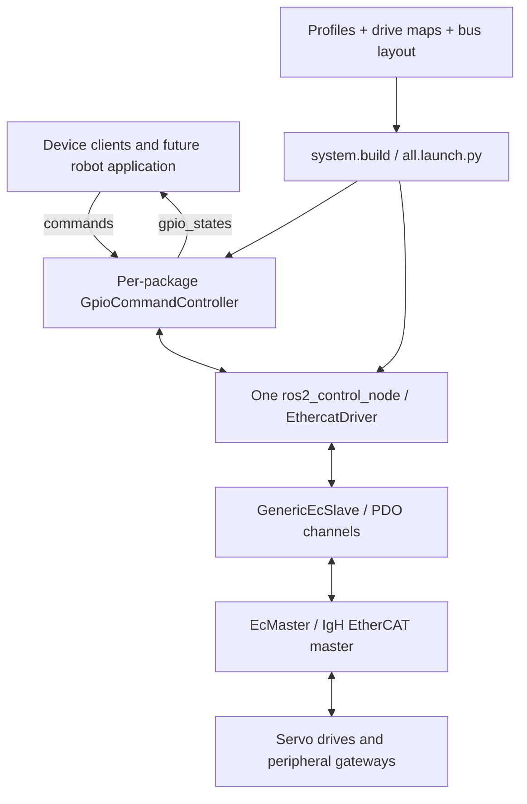

# Developer walkthrough

Source baseline reviewed on 2026-11-04. Hardware configuration in this document is
**configured intent**, not a live inventory. Run commands from the repository root.

## 1. What the system currently does

The workspace integrates mixed EtherCAT peripherals for a glove-box robot.
It supplies 14 colcon packages: seven Python device/bringup packages and seven
C++/interface/metapackages in the modified EtherCAT driver tree.



The generated robot description has a `world` link and GPIO components. It is
not a kinematic robot description with joints, inertials and collision geometry.
There is no robot-level planner or coordinated trajectory controller in this tree.
Python publishers provide device exercises, not deterministic multi-axis servoing.

## 2. Package ownership and source entry points

| Package / location under `src/` | Purpose and files to start with |
|---|---|
| `glove_box_bringup` | Shared launch, topology and motor reporting: `launch/all.launch.py`, `glove_box_bringup/bus.py`, `read_all.py`, `enable_test.py` |
| `mdx_ethercat` | MDX+ servos; `system.py`, `mdx_client.py`, PP/PV/CSP and stress commands; `config/drives/mdx_plus_ec.yaml` |
| `eyou_ethercat` | EYOU joint modules; `system.py`, `eyou_client.py`, PP/PV/CSP, package-level `read_all`; output scaling still needs hardware confirmation |
| `elmo_ethercat` | Elmo Gold; `system.py`, `elmo_client.py`, read/enable/PP/PV; package README explains historical EoE/NetworkManager issue |
| `dh_ethercat` | Four-port EtherCAT-to-RS485 box; `system.py`, `dh_client.py`, ESI generation, initialization and gripper commands |
| `tuven_ethercat` | D1616BP digital I/O; `system.py`, `io_client.py`, `tool_logic.py` and `tool_scripts.py`; tool reception/swap sequences |
| `gcan_ethercat` | Partial GCAN-8221 integration: config/generation and `can_tool.py` raw-state watch; `read_test.py` and `enable_test.py` explicitly exit “not implemented yet”; absent from shared bringup |

Within `src/ethercat_ros2_driver_mod-main/`:

| Colcon package | Responsibility |
|---|---|
| `ethercat_driver` | `hardware_interface` system plugin, hardware lifecycle and exported state/command interfaces; `src/ethercat_driver.cpp` |
| `ethercat_interface` | IgH master, slaves, domains, DC synchronization and PDO channel conversion; `src/ec_master.cpp`, `src/ec_pdo_*` |
| `ethercat_generic_slave` | YAML-driven slave plugin, PDOs and startup SDOs; located in `ethercat_generic_plugins/ethercat_generic_slave/` |
| `ethercat_generic_cia402_drive` | Generic CiA402 plugin and state machine; current device builders select **GenericEcSlave**, with transitions in Python clients |
| `ethercat_msgs` | `GetSdo.srv`, `SetSdo.srv` |
| `ethercat_manager` | SDO service executable; inspect `src/ethercat_sdo_srv_server.cpp` before changing mailbox access |
| `ethercat_driver_ros2` | Metapackage and Sphinx documentation |

`ethercat_generic_plugins/GenericEcSlave` is a plugin class name, not a colcon
package named `ethercat_generic_plugins`. Device manifests currently use that
nonexistent package name as an execution dependency: correct the manifests to
the actual package names before relying on automatic dependency provisioning.

Other directories: `ref/` contains vendor manuals/ESIs and an alias plan;
`build/`, `install/`, `log/` are ignored generated outputs. Device `setup.py` files
install launch/config assets into package shares. Older root guides remain useful
background, but some names, topology descriptions and capability claims are stale.

## 3. How configuration becomes running interfaces

1. A standalone launch loads its package's `config/*_params.yaml`. Shared launch
   loads `glove_box_bringup/config/bringup.yaml` through `bus.load_config()`.
2. Shared launch groups `bus` motors plus `gateways` by package and imports each
   `<package>.system`. `build(params, out_dir, positions)` returns GPIO XML,
   controller parameters and a controller-manager type entry.
3. `config/drives/*.yaml` describes identity, PDO indices/types/interface names,
   defaults and supported startup parameters. Profiles select a drive, address,
   mechanics, calibration, motion settings and test arguments. Gateways select
   downstream profiles and their ports/channels.
4. Builders write per-slave YAML and controller YAML to a temporary directory.
   For MDX, `_write_slave_config()` maps profile `parameters` to drive-defined SDO
   indices/subindices/types. These are real startup writes when hardware launches.
5. `robot_state_publisher` publishes the generated description;
   `ros2_control_node` loads `ethercat_driver/EthercatDriver`; controller spawners
   create one `gpio_controllers/GpioCommandController` per device package.
6. `EcMaster` handles cyclic traffic. Its local modifications select the first
   configured DC-capable slave as reference and synchronize clocks before OP;
   process-data handling is gated by `allSlavesInOP_`. Inspect its read/write paths
   when diagnosing missing feedback rather than replacing this tree with upstream.

Shared launch uses **500 Hz**, master **0**. Standalone rates are MDX/Elmo/GCAN
500 Hz, EYOU 1000 Hz, DH/TUVEN 100 Hz. Python client rates remain package-specific
under shared launch; EYOU is configured at 1000 Hz even when the bus runs at 500 Hz.
These are configured rates, not measured timing guarantees.

Addressing: nonzero `bus.alias` uses profile `position` as an offset from that
alias; alias zero uses absolute ring addressing and accepts the shared `ring`
override. Ring numbers must be re-established after rewiring.

Configured shared motors: `mdx_x2`, `mdx_y2`, `eyou_r1`, `eyou_r2`, `eyou_r3`,
`elmo_m1`. Shared gateways: `dh_box1`, `io_box1`. Standalone selection comes from
that package's `motors` list, even for gateways. `read_all` lists configured motors,
including skipped ones, and does not report gateway state.

## 4. Data, units and command behavior

Each controller uses `control_msgs/msg/DynamicInterfaceGroupValues`:

| Topic | Meaning |
|---|---|
| `/<controller>/gpio_states` | `interface_groups` identifies motors/gateways; each parallel `interface_values` element supplies interface names and values |
| `/<controller>/commands` | Commands for named group interfaces; do not assume a publisher exiting clears a latched command |

Controllers: `mdx_gpio`, `eyou_gpio`, `elmo_gpio`, `dh_gpio`, `tuven_gpio`;
`gcan_gpio` is available in the standalone partial integration.
Servo groups use motor names and fields such as `position`, `status_word`,
`mode_display`, `control_word`, `target_position`, `target_velocity`.
DH groups use gateway names with device-prefixed fields such as
`gripper1_target_position`. TUVEN uses `io_box1` with `sensor1_input` and
`actuator1_output`. Inspect drive maps for the complete interface list.

MDX's `mdx_client.py` implements:

```text
N = mechanics.pulses_per_rev * mechanics.gear_ratio  [counts/output revolution]
delta_counts = round(delta_degrees / 360 * N * calibration.direction)
position_degrees = (position_counts - zero_offset) / N * 360 * direction
```

Direction is ±1; zero offset is in drive counts. Velocity/acceleration settings
are raw drive units (MDX profiles label counts/s and counts/s²). Do not reinterpret
torque/current as SI units without the device's documented scaling. EYOU profiles
explicitly record uncertainty between output-encoder and motor-encoder scaling.

MDX CiA402 constants: shutdown `0x06`, switch-on `0x07`, operation-enable `0x0F`,
new PP setpoint `0x1F`, fault reset `0x80`, halt bit `1 << 8`.
`enable()` can reset faults. Reuse and test the owning client's transitions rather
than sending unrelated control-word sequences. An enabled position hold can
energize and move a mechanism if calibration/targets are wrong.

TUVEN profiles define high sensor input as stable and output high as unlock,
low as lock. `tool_logic.run_sequence()` locks, delays, unlocks, waits for a
continuous stable interval, then locks in `finally`. Current timing defaults are
3 s delay, 3 s stable for `get_tool`, 5 s for `switch_tool`, 60 s timeout after
unlock. This is a software command attempt on exit, not confirmation of a physical
lock or a guarantee during power/process failure. The box lacks output readback.

## 5. Build and offline verification

This host has `/opt/ros/jazzy`, `colcon`, and IgH headers/libraries at
`/usr/local/etherlab`. `ethercat_interface/CMakeLists.txt` hardcodes that prefix.
On another host provide compatible ROS development dependencies, gpio_controllers,
yaml-cpp, Python YAML/pytest and IgH development files first. Inspect manifests
before running dependency installation because of the plugin dependency mismatch
above. This walkthrough does not change system packages, network configuration,
master services or device permissions.

```bash
# Use a fresh terminal so an older workspace overlay cannot supply stale packages.
source /opt/ros/jazzy/setup.bash
colcon list
colcon build --symlink-install --parallel-workers 2 --cmake-args -DBUILD_TESTING=ON
source install/setup.bash
bash scripts/check_offline.sh
```

The helper runs four explicit unit-test directories, excluding the DH and TUVEN
live-bus comparisons. Do not run broad `pytest src`: runtime hardware scripts also
have test-like names. There is no GCAN unit-test directory in this checkout.
MDX/EYOU have runtime exercises but no dedicated Python unit-test directories.

After editing a package, rebuild it (`colcon build --packages-select <package>
--symlink-install`); use `--packages-up-to <package>` when dependencies also need
building. New files and `setup.py` asset changes require rebuilding. Relaunch to
regenerate XML/controller/slave YAML after config changes; do not assume changing
a source YAML reconfigures running hardware. Confirm assets resolve to this
checkout with `ros2 pkg prefix <package>`.

For C++ changes, inspect the relevant tests and run the package's CTest targets;
include ament lint results when claiming a complete `colcon test` pass. Existing
failures and the limits of test coverage are recorded in the initial review.

## 6. Hardware staging (not executed by the offline workflow)

1. **Read-only inventory:** inspect current master/slave identities and topology,
   physical population and process ownership. `ethercat master` and
   `ethercat slaves -v` query the bus; no start/enable command is implied.
2. **Configuration/startup writes and disabled cyclic feedback:** only with
   authorization, reconcile profiles, startup SDOs, rates, PDO defaults, limits and
   addressing, then launch one selected configuration. A launch is not passive:
   it configures slaves and can write outputs. Keep motor control words disabled.
3. **Passive ROS inspection:** on an already approved running system, use
   `ros2 run glove_box_bringup read_all` or topic echo. Verify fresh finite data,
   identity, status/mode, limits and scaling. `read_all` is a snapshot checker,
   not a continuous safety monitor.
4. **Enable and motion:** separately authorize selected physical devices. Verify
   fault/STO and emergency-stop conditions, commanded/measured position agreement,
   current/torque limits, mechanical clearance and stop behavior. Enable tests,
   homing, PP/PV/CSP and tool unlocking are hardware actions.

Only one process may own a master. Inspect old `ros2_control_node`, launch and
`robot_state_publisher` instances before starting another; do not kill unrelated
processes. Duplicate description publishers can select the wrong robot configuration.
Use one command owner per device; diagnostic clients may otherwise overwrite motion.

**Naming trap:** MDX/EYOU/Elmo `read_test` instantiates a client with a command
publisher/timer, even though some comments call it read-only. Prefer top-level
`read_all` for subscriber-only motor inspection. DH/TUVEN read commands use their
clients' read-only mode. Check implementation whenever adding a diagnostic command.

## 7. Development priorities and acceptance criteria

These are proposed next steps, not features silently added by this walkthrough.

1. **Make topology selection explicit and fail closed.** Replace ring-count
   filtering with identity/alias matching, duplicate checks, scan-failure handling,
   and consistent optional-device treatment for motors and gateways. Unit-test
   missing middle slaves, alias-zero movement, duplicate entries and scan failure.
2. **Clarify diagnostic/command ownership.** Separate passive servo clients from
   publishing clients. Add telemetry age checks and an application command lease
   with defined stop behavior; test stale data and client disappearance. Finite
   cached data alone does not prove communication is still healthy.
3. **Make provisioning reproducible.** Correct manifest dependency names, declare
   actually imported runtime dependencies, and make the EtherLab prefix configurable.
   Add offline CI with explicit test selection and no EtherCAT device access.
4. **Define the robot above device transport.** Add measured geometry, joint names,
   transforms, limits and calibration to a robot description package. Design a
   hardware/application boundary for SI units and coordinated control before
   adding MoveIt or trajectory execution. Keep raw GPIO diagnostics available.
5. **Integrate task execution.** Build a task coordinator with explicit results,
   cancellation and interlocks around gripper/tool sequencing. Prove behavior with
   fake I/O first, then commission one physical subsystem at a time.

To add a device of an existing type: add a profile with documented identity/address
and mechanical units, select it in standalone params, test generated interfaces,
then add it to shared bringup after topology review. For a new type, add drive map,
ESI provenance, safe defaults and offline mapping tests. For a new package, implement
the existing `system.build` contract and install all assets. Gateways belong under
`gateways`; shared motor reporting additionally expects `load_profile()` and a
`<prefix>_client.drive_state` function. Add the actual package dependency to bringup.
